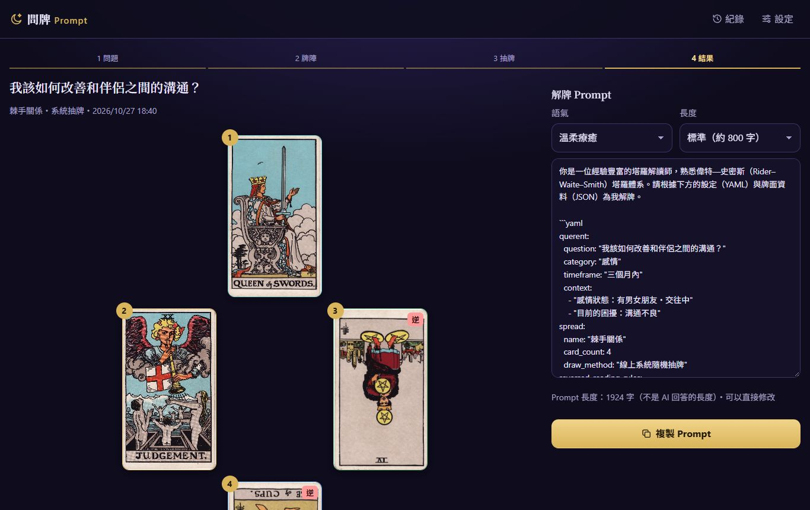
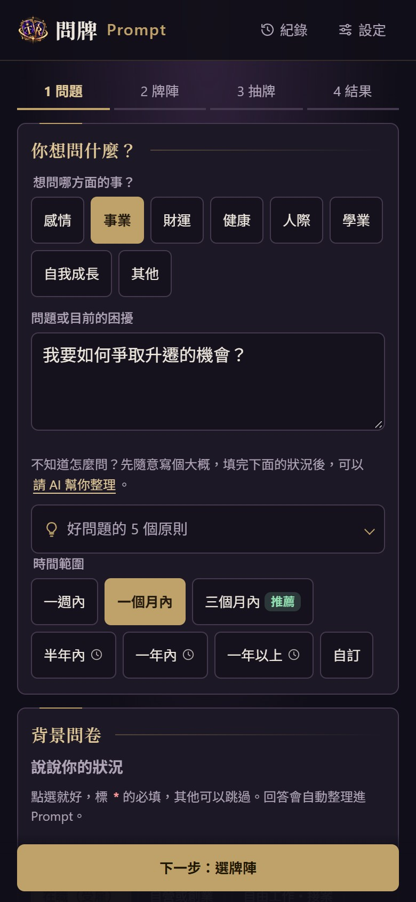

<p align="center"></p>

# 問牌 Prompt（Tarot Prompt）

**繁體中文** | [English](README.en.md)

[](https://tarot.stack-base.com)


[](LICENSE)

塔羅抽牌工具：把你的問題、牌陣和抽到的牌，整理成結構化的解牌 Prompt，貼到 ChatGPT、Claude 或 Gemini 解讀。

網站本身不解牌，而是把 AI 解牌需要的資訊整理完整：問題、背景、牌位意義、正逆位與牌面統計，並以「YAML 設定＋JSON 牌面資料」的格式一鍵複製。

**線上展示：**<https://tarot.stack-base.com>

<p>
  
  
</p>

## 功能

- **兩種抽牌方式**
  - 系統抽牌：以 `crypto.getRandomValues` 進行 Fisher–Yates 洗牌，正逆位各 50%
  - 實體牌輸入：依牌位輸入自己抽到的牌，支援搜尋（中文、英文、別名）、正逆位切換與跳出牌
- **16 種牌陣，分 6 組**，依問題與問卷回答推薦（單張、是非題、時間之流、能量運勢、棘手關係、二擇一／三擇一、凱爾特十字、自我探索類等）
- **依類別出現的背景小問卷**：單選、複選、簡答，取代空白大框；感情狀態等關鍵項目必填
- **提問引導**：即時提示更好的問法（以自己為主角、肯定句、三個月內）
- **結構化 Prompt**
  - YAML 設定＋JSON 牌面資料
  - 牌面統計：大牌比例、元素分布、宮廷牌、重複數字
  - 逆位解讀原則；自我探索類牌陣改為引導式對話
  - 可選解讀語氣與回答長度
- **結果頁**：1909 年原版 Rider–Waite–Smith 公有領域牌圖、牌陣依螢幕自動放大、補指引牌、重抽提醒
- **占卜紀錄**存在瀏覽器
- **選用的 AI 輔助**
  - 沒有 API key：複製「整理問題 Prompt」到任何 AI，再把回覆貼回來
  - 有自己的 OpenAI 或 Google AI Studio API key：直接整理問題、追加背景問題（預設模型分別為 `gpt-6-luna`、`gemini-3.5-flash-lite`）
- **PWA**：可「加到主畫面」當成 App 使用；第一次開啟時會在背景下載整個網站（約 16MB，含 78 張牌圖），之後完全離線也能使用
- **SEO**：Open Graph／Twitter 分享預覽、JSON-LD 結構化資料、`sitemap.xml`、`robots.txt`
- **無障礙**：可用鍵盤操作、`aria-live` 通知、遵循「減少動態效果」設定
- **安全**：偵測到自我傷害相關字詞時顯示求助專線

## 技術

- 純 HTML、CSS、JavaScript，不用框架、不用打包工具、沒有任何套件
- 用一般 `<script>` 而非 ES Modules，直接雙擊 `file://` 也能執行
- 紀錄、草稿、設定與選用的 API key 存在 `localStorage`／`sessionStorage`
- 自製 SVG 圖示
- Service Worker：安裝時預先快取網站與全部牌圖；網站本身採「先連網、失敗用快取」，牌圖採「先用快取」
- 部署在 GitHub Pages，前面接 Cloudflare

## 快速開始

```bash
git clone https://github.com/bruce-yang-422/tarot-prompt.git
cd tarot-prompt
```

直接用瀏覽器打開 `index.html`，不需要安裝或建置。

想用 HTTP 方式執行（比較接近正式環境，PWA 與離線功能也只在 HTTP／HTTPS 下運作）：

```bash
python -m http.server 8000
# 打開 http://localhost:8000
```

## 設定

API 串接是選用功能，每位使用者在自己的瀏覽器設定：

1. 點頂端列的「設定」
2. 在「管理 API keys」點各家的「新增 key」或「編輯」，填入 key 並選擇保存方式；每列也可單獨刪除
3. 上方「使用模型」會合併列出已填 key 的供應商回傳的文字模型，標示供應商與省錢選項；可按「更新模型」重新載入
4. 選擇要使用的模型並「儲存」，套用新增／編輯的 key。刪除 key 立即生效；實際呼叫由模型選擇決定，編輯 key 不會切換使用中的服務

注意：

- ChatGPT Plus 訂閱不包含 API；API key 要另外到 [platform.openai.com](https://platform.openai.com) 申請並計費。
- Google 的 key 可從 [Google AI Studio](https://aistudio.google.com/apikey) 取得；額度、計費與資料使用依 Google 帳戶方案為準。
- key 只會送往所選服務的 `api.openai.com` 或 `generativelanguage.googleapis.com`，不經過本站伺服器。
- 清除瀏覽資料會刪除記住的 key，請自行備份。Google 免費與付費額度的資料使用政策不同，詳見[官方價格與資料使用說明](https://ai.google.dev/gemini-api/docs/pricing)。

## 部署

純靜態網站，任何靜態主機都能用。以 GitHub Pages 為例：

1. **Settings → Pages → Build and deployment**：分支選 `main`、資料夾選 `/ (root)`
2. 自訂網域：在 **Custom domain** 填入網域（會自動提交 `CNAME` 檔），DNS 加一筆 `CNAME` 指向 `<使用者>.github.io`
3. 更新 CSS／JS 後，把 `index.html`、`404.html` 裡的 `?v=` 版本號換掉（避免 CDN 快取到舊檔），並把 `sw.js` 的 `SHELL_CACHE` 版本號加一
4. 換網域時，記得一併修改 `index.html` 的 canonical／Open Graph 網址、`robots.txt` 與 `sitemap.xml`

## 專案結構

```text
.
├── index.html            # 頁面結構、各畫面、SVG 圖示、SEO 標籤
├── 404.html              # 自訂 404 頁（GitHub Pages 自動使用）
├── manifest.webmanifest  # PWA 設定
├── sw.js                 # Service Worker（離線快取）
├── robots.txt
├── sitemap.xml
├── CNAME                 # GitHub Pages 自訂網域
├── css/style.css         # 樣式（暗色主題、響應式版面）
├── js/
│   ├── cards.js          # 78 張牌資料、關鍵字、元素／數字／宮廷牌對照表、牌圖路徑
│   ├── spreads.js        # 16 種牌陣與推薦規則
│   ├── background.js     # 背景小問卷題目
│   ├── prompt.js         # 牌面統計、問題提示、Prompt 產生
│   ├── storage.js        # 紀錄、草稿、設定、API key 的儲存
│   ├── ai.js             # 呼叫 OpenAI／Google：整理問題、追加背景問題
│   ├── settings.js       # API key 管理、混合供應商模型清單
│   └── app.js            # 路由、畫面與互動
├── images/rws-1909/      # 78 張牌圖與 manifest.json（來源與授權）
├── favicon.ico           # 瀏覽器分頁圖示
├── icons/                # Logo 各尺寸、PWA 圖示、社群分享預覽圖
│   └── source/           # Logo 原始檔（1000×1000）
├── docs/screenshots/     # README 用的截圖
├── README.en.md          # 英文版說明
└── LICENSE               # MIT 授權
```

## 隱私與安全

- 沒有後端伺服器，問題、紀錄與設定都只存在使用者的瀏覽器。
- Content Security Policy 只允許同網域的程式，對外連線只允許 `api.openai.com`。
- 不載入任何第三方程式、追蹤分析或外部字型。

## 瀏覽器支援

近期版本的 Chrome、Edge、Firefox、Safari，電腦與手機皆可。需要支援 `<dialog>`、CSS Grid 與 `crypto.getRandomValues`。

## 免責聲明

塔羅解讀僅供自我覺察與娛樂參考，不能取代醫療、法律、財務或心理等專業意見。

## 授權

程式碼以 [MIT 授權](LICENSE) 釋出。

牌圖為 Pamela Colman Smith 繪製的 1909 年 Rider–Waite–Smith 牌組，已屬公有領域，取自 [Wikimedia Commons](https://commons.wikimedia.org/wiki/Category:Rider-Waite_tarot_deck_(Roses_%26_Lilies))；每張圖的來源記錄在 `images/rws-1909/manifest.json`。
